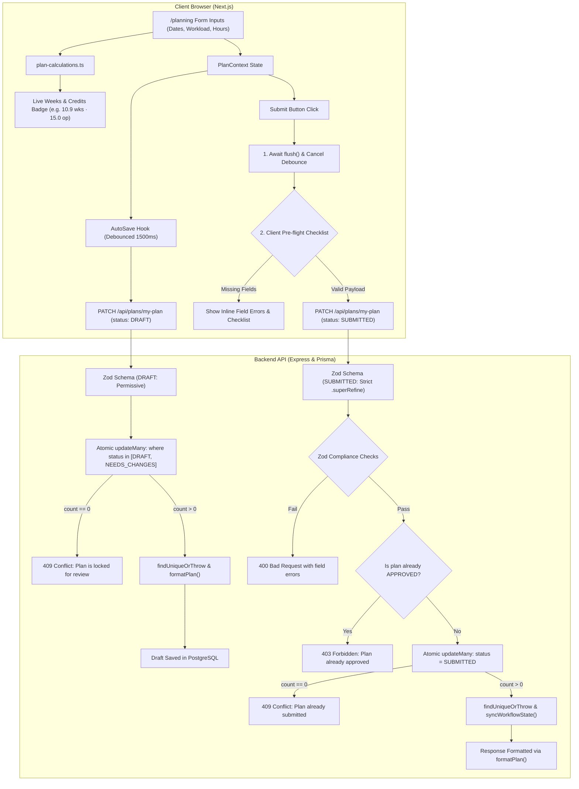

# Internship Plan Form Compliance and Schema Alignment

*   **Author:** Juho Simpanen
*   **Status:** Approved
*   **Date:** 2026-11-23

---

## Domain Terminology & Glossary

Key domain terms and abbreviations:

*   **`AMK` (*Ammattikorkeakoulu*)**: University of Applied Sciences in Finland (e.g. Metropolia).
*   **`op` / `opintopisteet`**: Finnish higher education study credits compliant with the European Credit Transfer and Accumulation System (ECTS). Under AMK accreditation rules, 1 credit (`op`) corresponds to approximately 27 hours of student workload.
*   **`kv-harjoittelu` (*Kansainvälinen harjoittelu*)**: International internship (internship placement carried out abroad).
*   **`h1` / `h2`**: Internal academic scope codes representing Harjoittelu 1 (first 15-credit module, 400 hours) and Harjoittelu 2 (second 15-credit module, 400 hours). A "combined" placement covers 30 credits (800 hours).
*   **`Päivätoteutus` / `Monimuoto`**: Degree program delivery modes (`DAYTIME` vs. `MULTIFORM`/flexible blended learning), mapped directly from `User.studyType`.
*   **`syncWorkflowState()`**: Internal service function in `backend/src/modules/internships/internship-workflow.service.ts` that synchronizes overall internship lifecycle stages (`PLAN_SUBMITTED`, `IN_PROGRESS`, etc.) upon plan status transitions.

---

## Overview

The internship plan form (`/planning`) serves as the official study contract and proposal submitted by a student prior to starting an internship. To satisfy institutional review requirements, the form must capture structured details covering the student, the employer (company name, street address, website), the specific work tasks, the internship duration (start and end dates), workload model (full-time or part-time), location scope (international / kv-harjoittelu), compensation model (paid or unpaid), and the student's personal learning goals.

Furthermore, based on the submitted schedule and workload terms, the system automatically calculates the total duration in internship weeks (inclusive calendar days divided by 7) and generates a real-time estimate of accumulating study credits (`opintopisteet`), evaluating estimated alignment with the 400-hour / 15-credit (or 800-hour / 30-credit) degree requirement.

Unpaid internships introduce increased institutional liability and supervision requirements. When an internship is marked unpaid, the form conditionally requires dedicated contact and role details for the employer's designated supervisor (full name, phone number, email address, and organizational title).

---

## Problem Statement

The existing planning interface and backend data model fall short of these institutional requirements in several key areas:
1. **Missing Employer Information**: The current data model only stores a single free-text `company` string. It does not capture physical address or website URL, preventing verification of employer legitimacy.
2. **Missing Internship Attributes**: The current schema does not record whether an internship is full-time or part-time, whether it takes place abroad (kv-harjoittelu), or whether it is paid or unpaid.
3. **Inadequate Supervisor Contact Information for Unpaid Placements**: Currently, supervisor fields (`supervisorName`, `supervisorContact`) are generic, optional, and unvalidated. For unpaid internships, institutions require dedicated fields (name, phone, email, organizational title) to confirm workplace accountability and safety.
4. **Lack of Automated Workload and Credit Calculation**: Students currently have no automated feedback indicating whether their selected dates and weekly hours yield the required 400 hours (15 ECTS credits). This leads to miscalculated end dates and under-scoped proposals.
5. **Autosave vs. Submission Concurrency Race Condition**: In [`PlanContext.tsx`](file:///home/juho/innovaatioprojekti/Harkkalogi/frontend/src/context/PlanContext.tsx), draft updates run on a 1500–2000ms debounce timer. If a student fills their last field and immediately clicks Submit, an in-flight or debounced draft autosave request can arrive at the backend *after* the submission request, reverting the status back to `DRAFT`.
6. **Autosave vs. Submission Validation Conflict**: If field completeness is enforced prematurely during intermediate draft editing, students cannot save incremental work before employer details or supervisor contacts are finalized.

---

## Goals

*   Define and integrate mandatory fields across the frontend plan form, state context, Zod schemas, and Prisma database models:
    *   Student identity display: Render authenticated student name, email, and study track (`Päivätoteutus` / `Monimuoto`) directly from `User` session state without duplicating profile fields onto the plan.
    *   Employer details: Legal company name, physical street address, and official website URL.
    *   Detailed work duties and tasks (minimum 100 words, matching codebase constant `MIN_DESCRIPTION_WORDS`).
    *   Internship start date and end date.
    *   Workload mode: Native Prisma enum (`WorkloadType`: `FULL_TIME` or `PART_TIME`).
    *   International internship flag (`isInternational`, boolean).
    *   Remuneration status (`isPaid`, boolean).
    *   Student's personal learning goals (minimum 3 structured goals).
*   Implement real-time automated duration and study credit calculations:
    *   Calculate inclusive calendar duration in weeks using UTC midnight normalization:
        $$\text{days} = \text{differenceInCalendarDays}(\text{endDate}, \text{startDate}) + 1, \quad \text{weeks} = \max\left(0, \text{round}\left(\frac{\text{days}}{7}, 1\right)\right)$$
    *   Calculate total planned hours:
        *   Full-time (`FULL_TIME`): Default 37.5 hours/week.
        *   Part-time (`PART_TIME`): Based on student-specified `hoursPerWeek` (mandatory positive number, 1–60 h/wk).
    *   Calculate estimated study credits (`opintopisteet`): Total hours divided by 27 hours/credit (standard AMK metric, 400 hours $\approx$ 15 op), rounded to 1 decimal place and capped to the degree period scope (15.0 op for single, 30.0 op for combined).
    *   **Advisory Credit Notice**: Reaching 15 credits is an advisory client-side checklist notice and confirmation warning, NOT a blocking backend HTTP 400 error, granting teachers the authority to approve legitimate non-standard/part-time split schedules.
*   Enforce conditional supervisor validation for unpaid placements:
    *   Supervisor full name (`supervisorName`).
    *   Supervisor telephone number (`supervisorPhone`).
    *   Supervisor email address (`supervisorEmail`).
    *   Supervisor title in organization (`supervisorTitle`).
    *   **Legacy Adapter**: Unpaid drafts created prior to migration storing contact info in legacy `supervisorContact` are accepted upon submission, with an inline client recommendation prompting the student to split into the dedicated fields.
*   Eliminate concurrency race conditions and enforce lifecycle state guard:
    *   Client cancels pending debounce timers and awaits in-flight saves before dispatching `SUBMITTED`.
    *   Server rejects any incoming student mutation request if the plan is already `SUBMITTED` or `APPROVED` (HTTP 409 Conflict).
    *   Server enforces atomic updates in PostgreSQL via `prisma.plan.updateMany` with status predicates to prevent TOCTOU race conditions.
*   Enforce strict validation exclusively upon plan submission (`SUBMITTED`) centralized in Zod (`savePlanSchema.superRefine()`), ensuring draft autosaving remains non-blocking for partial progress.

---

## Non-Goals

*   Persisting derived arithmetic metrics (`calculatedWeeks`, `estimatedCredits`, `estimatedHours`) as static database columns (derived dynamically in frontend helper and service response).
*   Duplicating student profile attributes (`studentPhone`, `studentNumber`) on `model Plan` (student identity is bound to `User`).
*   Hard-blocking submissions that calculate under 15 credits (remains an advisory warning to allow teacher discretion for modular split schedules).
*   Replacing system authentication or permitting manual overriding of primary account credentials.
*   Integrating external verification services (such as automated business registry lookup APIs or address geocoding services).
*   Modifying subsequent internship lifecycle phases (such as hour logging, weekly reporting, or teacher final evaluations) beyond surfacing the plan metadata.

---

## Open Questions (Resolved)

*   **Question 1 (Supervisor visibility for paid placements)**: *Resolved*. For paid internships, supervisor fields remain visible and accessible as optional contact fields.
*   **Question 2 (Credit calculation display cap)**: *Resolved*. The UI displays both the calculated estimate and the curriculum target cap (e.g. "15.0 / 15 op" with target-reached badge).
*   **Question 3 (Work Tasks description threshold)**: *Resolved*. Aligned with existing codebase constant `MIN_DESCRIPTION_WORDS = 100`.

---

## Critical User Journeys (CUJs)

### CUJ 1: Student Submits Paid Domestic Internship Plan
*   **Given**: An authenticated student with an existing draft or fresh plan.
*   **When**: The student enters employer details (company name, address, website), selects full-time, marks domestic, selects paid, specifies duties ($\ge 100$ words) and dates, adds 3 learning goals, and clicks submit.
*   **Then**: The submission validation verifies all mandatory fields without requiring supervisor contact details, transitions status to `SUBMITTED`, and updates the teacher queue.

### CUJ 2: Student Submits Unpaid Domestic or International Internship Plan
*   **Given**: An authenticated student with an unpaid internship placement.
*   **When**: The student toggles compensation to unpaid and attempts to submit without supervisor contact details.
*   **Then**: The form displays specific validation errors requiring supervisor name, phone number, email address, and organizational title. Upon filling these fields, submission succeeds.

### CUJ 3: Autosaving Work-in-Progress Draft with Incomplete Fields
*   **Given**: A student beginning the plan form with only company name and draft tasks filled.
*   **When**: The autosave timer triggers or the student navigates away.
*   **Then**: The system saves the partial draft payload successfully via `PATCH /api/plans/my-plan` without throwing validation errors.

### CUJ 4: Dynamic Workload and Study Credit Estimation
*   **Given**: A student configuring internship dates from September 1 to November 15, 2026 (76 inclusive calendar days).
*   **When**: The student toggles `Kokoaikainen` (Full-time).
*   **Then**: The interface reactively calculates 10.9 weeks, ~408 planned work hours, and 15.0 op with a target-reached badge. When switched to `Osa-aikainen` (20 hours/week), it updates to ~218 hours and ~8.1 op, informing the student of the remaining shortfall via an advisory notice.

### CUJ 5: Autosave Drain & Submission Lifecycle State Guard
*   **Given**: A student rapidly typing the last task description and clicking "Submit" within 500ms.
*   **When**: The submit handler executes.
*   **Then**: The client immediately cancels the pending 1500ms debounce timer, drains any in-flight request, and dispatches the `SUBMITTED` payload. The server transitions the plan to `SUBMITTED`. Any subsequent delayed draft payload receives an HTTP 409 rejection, preventing the plan from reverting to draft status.

---

## Proposed Architecture

### Architectural Overview

The architecture extends the data model, backend API validation layer, and frontend form orchestration across three primary tiers:

1. **Storage Tier (Prisma & PostgreSQL)**: Extends `model Plan` in `backend/prisma/schema.prisma` with typed columns representing the required employer details, terms of employment, and granular supervisor contacts. Uses a native non-nullable `enum WorkloadType { FULL_TIME, PART_TIME }`.
2. **API & Service Tier (Express, Zod, PlansService)**:
   * **Unified Endpoint Contract**: Preserves existing `PATCH /api/plans/my-plan?internshipId=...` handling both draft updates and final submissions.
   * **Centralized Zod Validation (`plans.schemas.ts`)**: Uses `.superRefine()` chained to the inner `body` object in `savePlanSchema` to enforce all mandatory constraints when `status === "SUBMITTED"`.
   * **Atomic Server Lifecycle Guard (`plans.service.ts`)**: Rejects student mutation requests if the record is already in `SUBMITTED` or `APPROVED` status, executing draft updates via `prisma.plan.updateMany` with status predicates.
   * **Dynamic Metric Derivation (`plans.service.ts`)**: `formatPlan()` derives `calculatedWeeks`, `estimatedHours`, and `estimatedCredits` dynamically on read without persisting redundant columns.
3. **Client Form & Context Tier (Next.js React & PlanContext)**:
   * Centralizes duration and credit math in pure helper module `frontend/src/lib/plan-calculations.ts` using UTC midnight normalization.
   * Drains autosave requests via `await flush()` upon submission click and awaits pending promises.
   * Disables all inputs in `/planning` when `status === "submitted" || status === "approved"`.
   * Evaluates dynamic checklist state in `PlanContext.tsx` and passes items to `<SubmissionChecklist items={...} />` in `page.tsx`.

### Data Flow Diagram



### Data Model Schema Changes

The `schema.prisma` file defines a native enum and extends `model Plan`:

```prisma
enum WorkloadType {
  FULL_TIME
  PART_TIME
}

model Plan {
  id                Int          @id @default(autoincrement())
  scope             String       @default("h1")
  
  // Employer Details
  company           String
  companyAddress    String?      // Street address, postal code, city
  companyWebsite    String?      // Official website URL
  
  // Internship Scope & Conditions
  startDate         DateTime?
  endDate           DateTime?
  workloadType      WorkloadType @default(FULL_TIME)
  hoursPerWeek      Float?       // Pre-existing column; required when workloadType == PART_TIME
  plannedHours      Int?         @default(400) // Target contract hours baseline
  isInternational   Boolean      @default(false)
  isPaid            Boolean      @default(true)
  
  // Tasks & Goals
  jobTitle          String?
  jobDescription    String?      @db.Text
  learningGoals     Json?
  
  // Workplace Supervisor (Mandatory when isPaid == false)
  supervisorName    String?
  supervisorPhone   String?
  supervisorEmail   String?
  supervisorTitle   String?      // Position or title in the organization
  supervisorContact String?      // Retained for backward compatibility
  
  // Review & Lifecycle
  assessment        String?      @db.Text
  status            PlanStatus   @default(DRAFT)
  submittedAt       DateTime?
  approvedAt        DateTime?
  teacherFeedback   String?
  createdAt         DateTime     @default(now())
  updatedAt         DateTime     @updatedAt

  studentId         Int
  student           User         @relation("StudentPlans", fields: [studentId], references: [id], onDelete: Cascade)

  internshipId      Int?         @unique
  internship        Internship?  @relation(fields: [internshipId], references: [id], onDelete: SetNull)

  @@index([studentId])
}
```

### Calculation Specifications

*   **Duration in Weeks (Inclusive Calendar Days with UTC Midnight Normalization)**:
    ```ts
    const msPerDay = 1000 * 60 * 60 * 24;
    const utcd1 = Date.UTC(startDate.getFullYear(), startDate.getMonth(), startDate.getDate());
    const utcd2 = Date.UTC(endDate.getFullYear(), endDate.getMonth(), endDate.getDate());
    const days = Math.floor((utcd2 - utcd1) / msPerDay) + 1;
    const weeks = Math.max(0, Math.round((days / 7) * 10) / 10);
    ```
    If either date is missing or invalid, calculation functions return `0` (never `NaN`).

*   **Total Planned Work Hours**:
    *   Full-time: $\text{hours} = \text{round}(\text{weeks} \times 37.5)$
    *   Part-time: $\text{hours} = \text{round}(\text{weeks} \times \text{hoursPerWeek})$

*   **Estimated Study Credits**:
    $$\text{credits} = \min\left(\text{maxCredits}, \text{round}\left(\frac{\text{hours}}{27}, 1\right)\right)$$
    Where $\text{maxCredits} = 30.0$ for combined scope and $15.0$ for standard single period.

### Validation Matrix (Draft vs Submission)

| Field | Draft Save (`DRAFT`) | Submission (`SUBMITTED`) |
| :--- | :--- | :--- |
| **Student Info** | Rendered from auth session | Verified attached to active student |
| **Company Name** | Optional / Partial | **Mandatory** (`min(2)`) |
| **Company Address** | Optional | **Mandatory** (`min(5)`) |
| **Company Website** | Optional | **Mandatory** (Valid domain/URL format) |
| **Start & End Dates** | Optional | **Mandatory** (`startDate <= endDate`) |
| **Workload Type** | Defaults to `FULL_TIME` | **Mandatory** (`FULL_TIME \| PART_TIME`) |
| **Hours per Week** | Optional | **Mandatory if `workloadType == PART_TIME`** ($1 \le h \le 60$) |
| **International Flag** | Defaults to `false` | **Mandatory** (`boolean`) |
| **Compensation Flag** | Defaults to `true` | **Mandatory** (`boolean`) |
| **Work Tasks** | Optional / Partial | **Mandatory** ($\ge 100$ words via `text.trim().split(/\s+/).length`) |
| **Learning Goals** | Optional ($\ge 0$) | **Mandatory** ($\ge 3$ goals with non-empty text) |
| **Calculated Credits** | Derived on the fly | **Advisory Warning**: Prompts confirmation if $< 15.0$ credits |
| **Supervisor Name** | Optional | **Mandatory if `isPaid == false`** |
| **Supervisor Phone** | Optional | **Mandatory if `isPaid == false`** (or legacy `supervisorContact`) |
| **Supervisor Email** | Optional | **Mandatory if `isPaid == false`** (or legacy `supervisorContact`) |
| **Supervisor Title** | Optional | **Mandatory if `isPaid == false`** (or legacy `supervisorContact`) |

### Form Layout & UI Organization

The planning page (`/planning`) groups input controls into five sections:

1. **Opiskelijan tiedot (Student Details)**:
   * Read-only summary cards displaying authenticated student name, email, and study track (`Päivätoteutus` / `Monimuoto`).
2. **Työnantajan tiedot (Employer Details)**:
   * Company legal name (`Yrityksen nimi`).
   * Company physical address (`Yrityksen osoite / toimipiste`).
   * Company website URL (`Verkkosivusto / www-osoite`).
3. **Harjoittelun ehdot, laajuus ja laskuri (Terms, Scope & Workload Calculator)**:
   * Start and end date pickers (`Aloituspäivä` ja `Lopetuspäivä`).
   * Workload selector toggle: `Kokoaikainen` (Full-time, 37.5 h/wk) vs `Osa-aikainen` (Part-time, with required `hoursPerWeek` input).
   * **Real-time Calculation Summary Card**:
     * Duration in weeks (`Harjoitteluviikot`: e.g. "10.9 viikkoa").
     * Estimated total hours (`Arvioidut työtunnit`: e.g. "408 tuntia").
     * Estimated credits (`Arvioidut opintopisteet`: e.g. "15.0 / 15 op" with visual progress bar and completion badge).
   * Placement location toggle: `Kotimaa` (Domestic) vs `Ulkomailla (Kv-harjoittelu)` (International).
   * Compensation selector: `Palkallinen` (Paid) vs `Palkaton` (Unpaid).
4. **Työpaikkaohjaajan tiedot (Workplace Supervisor)**:
   * Dynamic notice banner: If "Palkaton" is active, visual alert states that supervisor contact details are required for institutional verification of unpaid internships.
   * Fields: Full name (`Nimi`), Phone number (`Puhelinnumero`), Email (`Sähköposti`), and Position/Title (`Asema organisaatiossa / Titteli`).
   * If "Palkallinen" is active, supervisor fields remain available as optional contact entries.
   * If existing draft has legacy `supervisorContact` content, a helper banner displays the old text and assists the student in copying it into dedicated inputs.
5. **Työtehtävät ja tavoitteet (Tasks & Learning Objectives)**:
   * Detailed work tasks description (`Tarkat työtehtävät ja vastuut`) with live word counter and 100-word threshold indicator.
   * Student personal learning objectives (`Omat oppimistavoitteet`) with interactive list management (add, edit, remove).

*Read-Only State*: When `status === "submitted" || status === "approved"`, all form inputs, controls, and action buttons are disabled, displaying an informational banner stating that the plan is currently under teacher review.

---

## Risks & Mitigations

| Risk / Failure Mode | Severity | Impact | Mitigation Strategy |
| :--- | :--- | :--- | :--- |
| **Autosave race condition overwriting `SUBMITTED` state** | High | Plan silently reverts to draft status; teacher queue stalled | Client drains pending saves via `await flush()` upon submission; server atomic `updateMany` with status predicate rejects draft updates on locked plans with HTTP 409 Conflict. |
| **Post-submission mutation bypass** | High | Student modifies agreed contract terms while under teacher review | Server lifecycle guard rejects *all* student updates when `existing.status` is `SUBMITTED` or `APPROVED`, regardless of payload keys. |
| **Client autosave retry storm on HTTP 409** | Medium | Error banners flash after successful submission; wasteful retries | `useAutoSave.ts` catches 409 and 403 HTTP status codes, clears timers, sets `isDirtyRef.current = false`, and terminates retries immediately without triggering retry delays. |
| **Date arithmetic off-by-one across Finnish DST clock changes** | Medium | Discrepancy between client preview and backend derivation | Normalize dates to UTC midnight before day subtraction in `plan-calculations.ts` and `plans.service.ts`. |
| **Incomplete legacy drafts lacking separated supervisor contacts** | Medium | Unpaid plan submission failure for existing student drafts | Backward compatibility adapter accepts non-empty legacy `supervisorContact` string for historical drafts. |
| **Part-time schedule credit shortfalls** | Low | Legitimate modular or split schedules blocked | Credit threshold is enforced as an advisory UI checklist warning and confirmation dialog, NOT a hard blocking 400 error. |

---

## Alternatives Considered

### Alternative A: Storing Extended Attributes in a Generic JSON Metadata Column

*   **Pros**: Eliminates the need for Prisma database schema migrations; allows arbitrary key-value pairs to be added in the future without DDL schema evolution.
*   **Cons**: Sacrifices relational database integrity; prevents native SQL indexing, filtering, and aggregation for administrative reporting (e.g., querying all unpaid or international internships across study cohorts); removes Prisma client compile-time TypeScript type guarantees.
*   **Reason for Rejection**: Rejected by author: Relational columns provide strong database type safety, straightforward querying for administrative reporting (such as filtering international or unpaid placements), and direct TypeScript type generation through Prisma client.

### Alternative B: Persisting Derived Weeks and Credits as Database Columns

*   **Pros**: Allows direct SQL indexing on calculated weeks and credits.
*   **Cons**: Violates database normalization; writes redundant data on every autosave; introduces synchronization drift whenever dates or workload modes change.
*   **Reason for Rejection**: Rejected by author: Calculating duration and credits dynamically in the client utility and service formatting layer eliminates synchronization drift and avoids unnecessary database writes.

### Alternative C: Universal Strict Validation on All Save Operations (Blocking Autosave)

*   **Pros**: Simplifies backend validation to a single Zod schema; guarantees that any record persisted to the database is always 100% complete and valid according to institutional rules.
*   **Cons**: Severely disrupts student workflow during incremental drafting. Students routinely draft their plan across multiple sessions before receiving full company details or supervisor phone numbers, which would lead to blocked saves, data loss, or the entry of fake placeholder data.
*   **Reason for Rejection**: Rejected by author: Enforcing strict mandatory field validation during draft autosave prevents students from saving partial progress across sessions, causing data loss and encouraging fake placeholder data.

### Alternative D: Unconditionally Requiring Supervisor Contact for All Placements

*   **Pros**: Provides a uniform UI and validation rule across all placements without conditional branching.
*   **Cons**: In many large corporate or paid positions, direct supervisor details may not be finalized before the student's first working day. Furthermore, it directly contradicts the institutional requirement which mandates supervisor contact details only for unpaid positions to verify legal workplace oversight and student guidance.
*   **Reason for Rejection**: Rejected by author: Directly contradicts institutional policy which mandates supervisor contact details only for unpaid placements to verify legal workplace oversight and student guidance.

### Alternative E: Dedicated Submission RPC Endpoint (`POST /api/plans/my-plan/submit`)

*   **Pros**: Separates draft autosave schema from submission schema at the route level; isolates state transitions; eliminates the need for schema status branching.
*   **Cons**: Deviates from the existing repository API pattern where all plan state mutations flow through `PATCH /api/plans/my-plan?internshipId=...`; requires updating all existing frontend and test harnesses.
*   **Reason for Rejection**: Rejected by author: Centralizing validation in Zod `.superRefine()` and enforcing atomic SQL predicates maintains complete backward compatibility with the existing unified `PATCH` contract while fully mitigating race conditions.

---

## Non-Functional Requirements

### Security & Privacy
*   **Personal Contact Data**: Supervisor personal contact details (phone and email) represent personal data under GDPR. These fields must only be visible to the student author, the assigned supervising teacher, and system administrators.
*   **Access Control**: Plan updates remain restricted by role-based authorization checks: students can only modify their own plans while in `DRAFT` or `NEEDS_CHANGES` status, and cannot modify teacher feedback or force approval status.
*   **State Machine Protection**: Once a plan transitions to `SUBMITTED`, student draft updates are rejected with HTTP 409 Conflict until a teacher requests changes.

### Performance & Latency
*   **Autosave Optimization**: Debounced autosaving (1500ms) with pre-submission draining prevents excessive database write load and eliminates race conditions.
*   **Client Calculation Efficiency**: Real-time duration and credit calculation in `plan-calculations.ts` executes synchronously in $< 1$ms with negligible UI latency.

### Rollout & Compatibility
*   **Backward Compatibility**: All new columns in `schema.prisma` are nullable with safe defaults, ensuring that existing completed or ongoing plans and internships remain valid without destructive backfills.
*   **Legacy Data Tolerance**: Existing unpaid drafts with text in `supervisorContact` remain submittable.

---

## Detailed Implementation Plan

The implementation is partitioned into five sequential, testable phases. Each phase concludes with an executable verification checkpoint.

### Phase 1: Database Schema & Migration

#### 1. `backend/prisma/schema.prisma` (Modify)
*   **Scope**: Database Data Modeling
*   **Proposed Changes**:
    *   Define `enum WorkloadType { FULL_TIME, PART_TIME }`.
    *   Add `companyAddress String?` (street address, city, postal code).
    *   Add `companyWebsite String?` (official URL of employer).
    *   Add `workloadType WorkloadType @default(FULL_TIME)`.
    *   Add `isInternational Boolean @default(false)` (international internship flag).
    *   Add `isPaid Boolean @default(true)` (remuneration status flag).
    *   Add `supervisorPhone String?` (direct contact phone for supervisor).
    *   Add `supervisorEmail String?` (official email address for supervisor).
    *   Add `supervisorTitle String?` (position or organizational title).
    *   Retain existing `hoursPerWeek Float?`, `plannedHours Int? @default(400)`, and `supervisorContact String?`.
*   **Rationale**: Persists required institutional fields in PostgreSQL with relational type safety.

#### 2. `backend/prisma/migrations/<timestamp>_add_plan_compliance_fields/migration.sql` (Create)
*   **Scope**: Database Migration Script
*   **Proposed Changes**:
    *   Generated via `cd backend && npx prisma migrate dev --name add_plan_compliance_fields`.
    *   Executes `CREATE TYPE "WorkloadType"` and `ALTER TABLE "Plan" ADD COLUMN` statements with nullable defaults.
*   **Rationale**: Applies schema modifications to the database safely without breaking historical internship records.

**Phase 1 Checkpoint**: Run `cd backend && npx prisma migrate dev && npm run build` to verify clean schema generation and compilation.

---

### Phase 2: Backend Logic, Schemas & API Integration Tests

#### 3. `backend/src/modules/plans/plans.schemas.ts` (Modify)
*   **Scope**: Zod API Validation Layer
*   **Proposed Changes**:
    *   Attach `.superRefine()` directly to the inner `body` object of `savePlanSchema` to preserve `AnyZodObject` middleware compatibility in `validate.middleware.ts`:
        ```ts
        export const savePlanSchema = z.object({
          body: z.object({
            scope: z.enum(["h1", "h2", "combined"]).optional(),
            company: z.string().trim().optional(),
            companyAddress: z.string().trim().optional(),
            companyWebsite: z.string().trim().optional(),
            jobTitle: z.string().trim().optional(),
            supervisorName: z.string().trim().optional(),
            supervisorPhone: z.string().trim().optional(),
            supervisorEmail: z.string().trim().optional(),
            supervisorTitle: z.string().trim().optional(),
            supervisorContact: z.string().trim().optional(),
            startDate: z.string().optional(),
            endDate: z.string().optional(),
            workloadType: z.enum(["FULL_TIME", "PART_TIME"]).optional(),
            hoursPerWeek: z.union([z.number(), z.string()]).optional(),
            plannedHours: z.union([z.number(), z.string()]).optional(),
            isInternational: z.boolean().optional(),
            isPaid: z.boolean().optional(),
            jobDescription: z.string().optional(),
            learningGoals: z.array(learningGoalSchema).optional(),
            assessment: z.string().optional(),
            status: z.enum(["DRAFT", "SUBMITTED", "APPROVED", "NEEDS_CHANGES"]).optional(),
            teacherFeedback: z.string().optional(),
            internshipId: z.union([z.number(), z.string()]).optional(),
          }).superRefine((data, ctx) => {
            if (data.status === "SUBMITTED") {
              if (!data.company || data.company.trim().length < 2) {
                ctx.addIssue({ code: z.ZodIssueCode.custom, message: "Company name is required", path: ["company"] });
              }
              if (!data.companyAddress || data.companyAddress.trim().length < 5) {
                ctx.addIssue({ code: z.ZodIssueCode.custom, message: "Company address is required", path: ["companyAddress"] });
              }
              if (!data.companyWebsite || !/^[a-zA-Z0-9.-]+\.[a-zA-Z]{2,}/.test(data.companyWebsite.trim())) {
                ctx.addIssue({ code: z.ZodIssueCode.custom, message: "Valid company website is required", path: ["companyWebsite"] });
              }
              if (!data.startDate) {
                ctx.addIssue({ code: z.ZodIssueCode.custom, message: "Start date is required", path: ["startDate"] });
              }
              if (!data.endDate) {
                ctx.addIssue({ code: z.ZodIssueCode.custom, message: "End date is required", path: ["endDate"] });
              }
              if (data.startDate && data.endDate && new Date(data.startDate) > new Date(data.endDate)) {
                ctx.addIssue({ code: z.ZodIssueCode.custom, message: "End date must be after start date", path: ["endDate"] });
              }
              if (data.workloadType === "PART_TIME") {
                const hpw = Number(data.hoursPerWeek);
                if (isNaN(hpw) || hpw < 1 || hpw > 60) {
                  ctx.addIssue({ code: z.ZodIssueCode.custom, message: "Hours per week must be between 1 and 60 for part-time workload", path: ["hoursPerWeek"] });
                }
              }
              const words = data.jobDescription ? data.jobDescription.trim().split(/\s+/).filter(Boolean).length : 0;
              if (words < 100) {
                ctx.addIssue({ code: z.ZodIssueCode.custom, message: `Job description must be at least 100 words (currently ${words})`, path: ["jobDescription"] });
              }
              const validGoals = Array.isArray(data.learningGoals) ? data.learningGoals.filter(g => g && g.text && g.text.trim().length > 0) : [];
              if (validGoals.length < 3) {
                ctx.addIssue({ code: z.ZodIssueCode.custom, message: "At least 3 learning goals are required", path: ["learningGoals"] });
              }
              if (data.isPaid === false) {
                const hasLegacy = Boolean(data.supervisorContact && data.supervisorContact.trim().length > 0);
                if (!hasLegacy) {
                  if (!data.supervisorName || data.supervisorName.trim().length === 0) {
                    ctx.addIssue({ code: z.ZodIssueCode.custom, message: "Supervisor name is required for unpaid internships", path: ["supervisorName"] });
                  }
                  if (!data.supervisorPhone || data.supervisorPhone.trim().length === 0) {
                    ctx.addIssue({ code: z.ZodIssueCode.custom, message: "Supervisor phone is required for unpaid internships", path: ["supervisorPhone"] });
                  }
                  if (!data.supervisorEmail || !/^[^\s@]+@[^\s@]+\.[^\s@]+$/.test(data.supervisorEmail.trim())) {
                    ctx.addIssue({ code: z.ZodIssueCode.custom, message: "Valid supervisor email is required for unpaid internships", path: ["supervisorEmail"] });
                  }
                  if (!data.supervisorTitle || data.supervisorTitle.trim().length === 0) {
                    ctx.addIssue({ code: z.ZodIssueCode.custom, message: "Supervisor title is required for unpaid internships", path: ["supervisorTitle"] });
                  }
                }
              }
            }
          }),
        });
        ```

#### 4. `backend/src/modules/plans/plans.service.ts` (Modify)
*   **Scope**: Backend Service Logic
*   **Proposed Changes**:
    *   In `savePlan()`:
        *   Guard approved plans: `if (existing && existing.status === PlanStatus.APPROVED) throw new AppError("Forbidden: Approved plans cannot be modified by students", 403);`
        *   Guard submitted plans: `if (user.role === "STUDENT" && existing && existing.status === PlanStatus.SUBMITTED) throw new AppError("Cannot modify an already submitted plan", 409);`
        *   Execute updates via atomic predicate:
            ```ts
            const updateResult = await prisma.plan.updateMany({
              where: {
                id: existing.id,
                status: { in: [PlanStatus.DRAFT, PlanStatus.NEEDS_CHANGES] },
              },
              data: {
                company: input.company !== undefined ? input.company : existing.company,
                companyAddress: input.companyAddress !== undefined ? input.companyAddress : existing.companyAddress,
                companyWebsite: input.companyWebsite !== undefined ? input.companyWebsite : existing.companyWebsite,
                jobTitle: input.jobTitle !== undefined ? input.jobTitle : existing.jobTitle,
                supervisorName: input.supervisorName !== undefined ? input.supervisorName : existing.supervisorName,
                supervisorPhone: input.supervisorPhone !== undefined ? input.supervisorPhone : existing.supervisorPhone,
                supervisorEmail: input.supervisorEmail !== undefined ? input.supervisorEmail : existing.supervisorEmail,
                supervisorTitle: input.supervisorTitle !== undefined ? input.supervisorTitle : existing.supervisorTitle,
                supervisorContact: input.supervisorContact !== undefined ? input.supervisorContact : existing.supervisorContact,
                startDate: startDate !== null ? startDate : existing.startDate,
                endDate: endDate !== null ? endDate : existing.endDate,
                workloadType: input.workloadType !== undefined ? input.workloadType : existing.workloadType,
                hoursPerWeek,
                plannedHours,
                isInternational: input.isInternational !== undefined ? input.isInternational : existing.isInternational,
                isPaid: input.isPaid !== undefined ? input.isPaid : existing.isPaid,
                jobDescription: input.jobDescription !== undefined ? input.jobDescription : existing.jobDescription,
                learningGoals: input.learningGoals !== undefined ? (input.learningGoals as any) : (existing.learningGoals as any),
                assessment: input.assessment !== undefined ? input.assessment : existing.assessment,
                status,
                submittedAt,
                approvedAt,
                teacherFeedback: input.teacherFeedback !== undefined ? input.teacherFeedback : existing.teacherFeedback,
              },
            });
            if (updateResult.count === 0) {
              throw new AppError("Plan is locked for review (status changed)", 409);
            }
            const updated = await prisma.plan.findUniqueOrThrow({
              where: { id: existing.id },
              include: { internship: true, student: true },
            });
            ```
        *   Map all 8 fields in `prisma.plan.create` when creating initial plan records.
    *   Update `formatPlan()` to calculate and return derived metrics:
        ```ts
        const start = plan.startDate ? new Date(plan.startDate) : null;
        const end = plan.endDate ? new Date(plan.endDate) : null;
        let calculatedWeeks = 0;
        let estimatedHours = 0;
        let estimatedCredits = 0;
        if (start && end && start <= end) {
          const msPerDay = 1000 * 60 * 60 * 24;
          const utcd1 = Date.UTC(start.getFullYear(), start.getMonth(), start.getDate());
          const utcd2 = Date.UTC(end.getFullYear(), end.getMonth(), end.getDate());
          const days = Math.floor((utcd2 - utcd1) / msPerDay) + 1;
          calculatedWeeks = Math.max(0, Math.round((days / 7) * 10) / 10);
          const hpw = plan.workloadType === "PART_TIME" ? (Number(plan.hoursPerWeek) || 0) : 37.5;
          estimatedHours = Math.round(calculatedWeeks * hpw);
          const maxCreds = plan.scope === "combined" ? 30.0 : 15.0;
          estimatedCredits = Math.min(maxCreds, Math.round((estimatedHours / 27) * 10) / 10);
        }
        return {
          ...existingFields,
          companyAddress: plan.companyAddress || "",
          companyWebsite: plan.companyWebsite || "",
          workloadType: plan.workloadType || "FULL_TIME",
          isInternational: Boolean(plan.isInternational),
          isPaid: plan.isPaid !== false,
          supervisorPhone: plan.supervisorPhone || "",
          supervisorEmail: plan.supervisorEmail || "",
          supervisorTitle: plan.supervisorTitle || "",
          calculatedWeeks,
          estimatedHours,
          estimatedCredits,
        };
        ```

#### 5. `backend/src/modules/plans/__tests__/plans.test.ts` (Modify)
*   **Scope**: Backend Integration Test Suite
*   **Proposed Changes**:
    *   Update existing Ville submit test fixture (line 96) with valid compliant data (100+ word description, company address, website, workload type) so baseline submission succeeds.
    *   Add test: "saves partial draft and derives dynamic weeks, hours, and credits in formatPlan".
    *   Add test: "blocks draft autosave with HTTP 409 if plan is already submitted".
    *   Add test: "blocks any student mutation if plan is already submitted".
    *   Add test: "successfully submits paid plan with minimal supervisor information".
    *   Add test: "fails submission of unpaid plan when supervisor contact details are missing (400 Bad Request)".
    *   Add test: "successfully submits unpaid plan when all supervisor contact details are provided".
    *   Add test: "successfully submits unpaid plan with legacy supervisorContact string".

**Phase 2 Checkpoint**: Run `cd backend && npm test` to verify all backend unit and integration tests pass.

---

### Phase 3: Frontend Calculation Engine & Unit Tests

#### 6. `frontend/src/lib/plan-calculations.ts` (Create)
*   **Scope**: Frontend Utility Module
*   **Proposed Changes**:
    *   `calculateDurationWeeks(startDate: string, endDate: string): number`: Computes inclusive calendar days normalized to UTC midnight divided by 7, rounded to 1 decimal place. Returns 0 if either date is invalid.
    *   `calculateEstimatedHours(weeks: number, workloadType: string, hoursPerWeek?: number | string): number`: Computes `Math.round(weeks * (workloadType === "PART_TIME" ? (Number(hoursPerWeek) || 0) : 37.5))`.
    *   `calculateEstimatedCredits(totalHours: number, scope?: string): { credits: number; targetCredits: number; isMet: boolean }`: Computes `Math.min(targetCredits, Math.round((totalHours / 27) * 10) / 10)`.

#### 7. `frontend/src/lib/__tests__/plan-calculations.test.ts` (Create)
*   **Scope**: Frontend Unit Tests
*   **Proposed Changes**:
    *   Test reference scenario: Sept 1 to Nov 15, 2026 yields exactly 10.9 weeks and 408 hours at 37.5 h/wk.
    *   Test part-time calculation: 10.9 weeks at 20 h/wk yields 218 hours and 8.1 credits.
    *   Test invalid/empty dates return 0 weeks and 0 credits without throwing or returning `NaN`.
    *   Test single vs combined scope credit targets (15.0 vs 30.0).

#### 8. `frontend/src/hooks/useAutoSave.ts` (Modify)
*   **Scope**: Client AutoSave Hook
*   **Proposed Changes**:
    *   In `runSave()` catch block: if `err instanceof ApiError && (err.status === 409 || err.status === 403)`:
        *   Clear `timerRef.current`.
        *   Set `isDirtyRef.current = false`.
        *   Set `setStatus("saved")`.
        *   Return `false` immediately without scheduling retry timeouts.

**Phase 3 Checkpoint**: Run `cd frontend && npm test` to verify calculation engine and autosave hook unit tests pass.

---

### Phase 4: Client State Context & Form User Interface

#### 9. `frontend/src/context/PlanContext.tsx` (Modify)
*   **Scope**: React Client Context
*   **Proposed Changes**:
    *   Extend `PlanState` interface with `companyAddress`, `companyWebsite`, `workloadType`, `isInternational`, `isPaid`, `supervisorPhone`, `supervisorEmail`, `supervisorTitle`.
    *   Update `EMPTY_PLAN` and `DEFAULT_PLAN` with defaults (`isPaid: true`, `isInternational: false`, `workloadType: "FULL_TIME"`).
    *   Update `toPlanPayload()` to include all new attributes.
    *   Update `syncPlan()` inside `useEffect()` to hydrate all new fields from `activeInternship.plan`.
    *   In `submitPlan()`:
        *   Call `await flush()` to drain pending autosave debounce timers.
        *   Wrap submission request in `try/catch`:
            ```ts
            try {
              const res = await apiFetch(`/plans/my-plan?internshipId=${activeInternship.id}`, {
                method: "PATCH",
                body: JSON.stringify(toPlanPayload(plan, "SUBMITTED")),
              });
              await refreshInternships();
              setPlan((prev) => ({ ...prev, status: "submitted", submittedAt: new Date().toISOString() }));
              return { success: true };
            } catch (err: any) {
              return { success: false, message: err.message || "Failed to submit plan." };
            }
            ```
    *   Update `checklist` calculation state evaluating boolean conditions (`isEmployerFilled`, `isTermsFilled`, `isSupervisorFilled`, `isWordCountMet`, `hasEnoughGoals`, `isCreditTargetMet`).

#### 10. `frontend/src/app/(dashboard)/planning/page.tsx` (Modify)
*   **Scope**: Next.js Planning Page
*   **Proposed Changes**:
    *   Import `useAuth` from `@/context/AuthContext`.
    *   Structure the UI into five sections:
        1. **Student Details**: Read-only display of authenticated `user.name`, `user.email`, `user.studyType`.
        2. **Employer Details**: Inputs for company name, street address, and website URL.
        3. **Terms, Scope & Workload Calculator**: Date pickers, full-time/part-time toggle, live calculation badge for weeks, hours, and credits (`plan-calculations.ts`).
        4. **Workplace Supervisor**: Highlighted conditional banner for unpaid internships; inputs for supervisor name, phone, email, and title. Legacy contact text helper note if present.
        5. **Tasks & Learning Goals**: Textarea for detailed duties with 100-word counter, interactive learning goals list.
    *   Disable all input fields and action buttons when `status === "submitted" || status === "approved"`.
    *   Pass context-driven checklist array to `<SubmissionChecklist items={checklistItems} />`.

**Phase 4 Checkpoint**: Run `cd frontend && npm run build` to verify clean compilation with zero TypeScript errors.

---

### Phase 5: End-to-End Verification & Edge-Case Validation

Execute manual and automated scenarios:
1. Open `/planning` as student.
2. Enter dates `2026-09-01` to `2026-11-15` (76 inclusive calendar days), select `FULL_TIME`. Verify that the live calculation card displays 10.9 weeks, ~408 hours, and 15.0 credits with target-reached badge.
3. Switch to `PART_TIME` with `20` h/week. Verify calculation updates to ~218 hours and ~8.1 credits with an advisory warning that additional hours are required.
4. Select "Palkaton" (Unpaid), attempt to submit with empty supervisor details; confirm that submission is blocked with descriptive errors for supervisor name, phone, email, and title.
5. Fill supervisor details, submit; confirm that status transitions to `SUBMITTED`.
6. Rapidly edit a field and submit; verify debounce timer is flushed, in-flight draft drains, and subsequent draft requests return HTTP 409 without retry storms.
7. Test with "Palkallinen" (Paid) plan, confirm that supervisor details are not required for successful submission.
8. Verify that once submitted, all form fields are disabled (read-only) with a banner indicating teacher review is pending.

--------------------------------------------------------------------------------

<!-- Provenance: Indicates initial structural drafting via EGM. -->

*Drafted with EGM*
