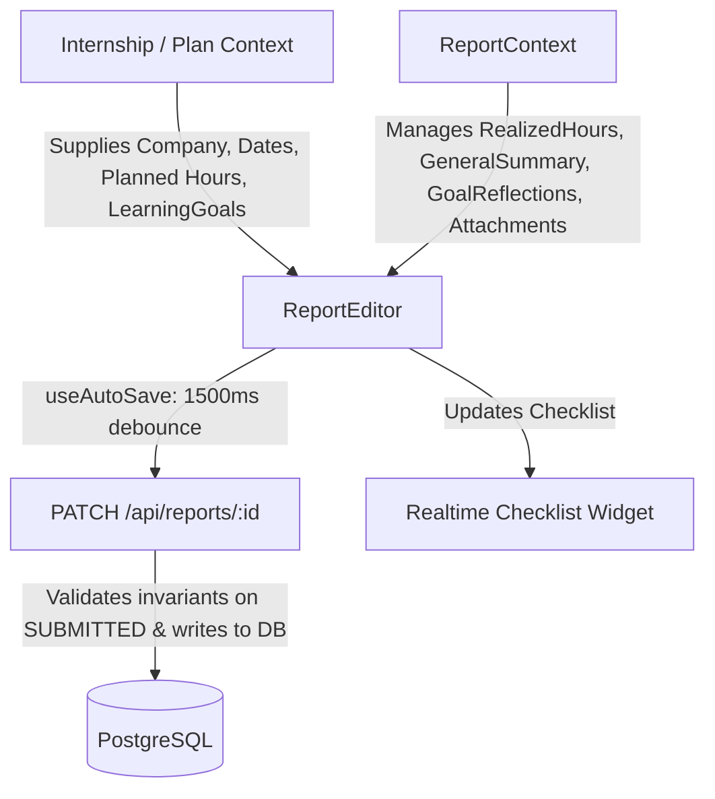

# Internship Report Modernization & Process Alignment (Plan → Report → Evaluation)

* **Author:** Juho Simpanen
* **Status:** Approved
* **Date:** 2026-11-24

---

## Overview

This technical design document outlines the architectural and UI modernization of the Internship Report module (`frontend/src/app/(dashboard)/report/page.tsx`), aligning it with the completed Internship Plan (`planning/page.tsx`) and the post-internship Guidance Evaluation (`guidance-evaluation/page.tsx`).

The goal is to establish a unified, structured 3-stage internship flow:
1. **Step 1 (Plan / Harjoittelusuunnitelma)**: Defines workplace details, terms, workload calculation, and approved learning goals.
2. **Step 2 (Report / Harjoitteluraportti)**: Inherits approved Plan metadata as read-only context, provides a hybrid multi-part reflection mapped directly to the agreed learning goals plus general workplace competencies, requires the official work certificate, and strips artificial supervisor checkboxes.
3. **Step 3 (Evaluation / Ohjauksen arviointi)**: Evaluates workplace and academic supervision via dedicated rubrics and University of Applied Sciences (UAS / *Ammattikorkeakoulu*) checklist items once the report is approved by the teacher.

Because the system is currently in active development, database schemas, API interfaces, seed data, and state stores are refactored cleanly without maintaining legacy serialization shims.

---

## The Problem

The current implementation of the Report view suffers from several design and structural deficiencies:
1. **Redundant & Error-Prone Data Re-entry**: The report page asks students to manually re-type `Company`, `Start date`, `End date`, and `Total hours` into blank text inputs, ignoring the already approved data in Step 1 (`Plan`).
2. **Pedagogical Disconnect in Self-Reflection**: The report provides a single unstructured textarea with a tip to "connect your tasks to learning goals," but never shows the student what their approved goals actually were.
3. **Conflated Responsibilities & Artificial Gating**: The Report contains a solitary checkbox (`Supervisor feedback requested / completed`), creating confusion with Step 3 (`guidance-evaluation`), where supervision is evaluated thoroughly with 5-star rubrics and qualitative checklist items.
4. **Visual & Architectural Inconsistency**: The report page uses English labels and static form controls, lacking the Finnish localization, collapsible card architecture (`CollapsiblePlanSection`), and design token polish established on the Plan page.
5. **Workflow & Precondition Gaps**: Navigating to `/report` without an approved plan can lead to runtime inconsistencies, and submitting a report previously lacked clear guidance regarding when Step 3 unlocks.

---

## Goals

* **Goal 1 (Automatic Plan Context Inheritance & Editable Realized Hours)**: Present approved employer details, official dates, and planned scope/hours from Step 1 as a read-only collapsible summary in Section 1 of the report, while providing a single editable "Realized Hours" (Toteutuneet työtunnit) field prefilled with the planned hours and bounded between 1 and 2000 hours.
* **Goal 2 (Hybrid Multi-Part Reflection with Enum Status)**: Render the student's approved learning goals from the Plan as structured reflection prompts with status indicators (*Saavutettu / Osittain saavutettu / Ei saavutettu*), alongside a general workplace learning textarea, backed by a live combined word counter (target: 300+ words).
* **Goal 3 (Schema & Checklist Hygiene)**: Completely remove `supervisorFeedbackRequested` from Zod validation schemas, API contracts, context state, and submission checklist blockers.
* **Goal 4 (Component & Design Harmony)**: Adopt the layout conventions of `planning/page.tsx`, utilizing `ProcessPageHeader`, `CollapsiblePlanSection`, localized Finnish typography, and consistent feedback banners.
* **Goal 5 (Linear Lifecycle Gating & Preconditions)**:
  - Protect `/report` with a `LockedNoticeCard` precondition guard when `plan.status !== "APPROVED"`.
  - When submitted, transition to an "Odottaa opettajan tarkistusta" banner explaining that Step 3 (`/guidance-evaluation`) unlocks after the supervising teacher approves the report.

---

## Non-Goals

* Overhauling the teacher review suite (`teacher-view/page.tsx`) beyond maintaining stable backend serialization and API compatibility.
* Modifying the star-rating evaluation criteria or UAS checklist subjects in `guidance-evaluation/page.tsx` (Step 3).
* Introducing complex attachment classification schemas; requiring at least one uploaded attachment satisfies work certificate verification.

---

## Critical User Journeys (CUJs)

### CUJ 1: Student Navigates to Report Before Plan Approval
* **Given**: The student has not submitted a plan, or their plan is still in `DRAFT` / `SUBMITTED`.
* **When**: The student navigates to `/report`.
* **Then**: The page renders a `LockedNoticeCard` stating that the report unlocks once the internship plan is approved by the teacher, with a CTA to `/planning`.

### CUJ 2: Student Completes and Submits Report for an Approved Internship
* **Given**: The student has an approved internship plan with company details, dates (e.g. 1.6.–31.8.2026), 400 h target scope, and 3 approved learning goals.
* **When**: The student navigates to `/report`.
* **Then**:
  - Section 1 displays approved employer and schedule information in a read-only collapsible card. Realized hours is prefilled to 400 h.
  - Section 2 displays 3 goal cards showing the original goal text with dedicated reflection textareas and achievement status toggles (*Saavutettu / Osittain saavutettu / Ei saavutettu*), plus a general learning textarea.
  - Section 3 displays the attachment zone requiring a work certificate.
  - The submission checklist updates in real-time requiring workplace validity, 300+ total reflection words, and at least one uploaded work certificate.

### CUJ 3: Student Submits Report and Awaits Teacher Review
* **Given**: The student has completed reflections (300+ words) and attached `Tyotodistus.pdf`.
* **When**: The student clicks "Lähetä raportti tarkistettavaksi".
* **Then**:
  - The report status transitions to `SUBMITTED`.
  - The banner and sidebar transition to an "Under Review" state informing the student: *"Raportti toimitettu tarkistettavaksi. Vaihe 3 (Ohjauksen arviointi) avautuu, kun opettaja on hyväksynyt raportin."*

---

## Technical Plan (Architecture)

### 1. Data Model & Schema Modernization

In `backend/prisma/schema.prisma`, update the `Report` model to store structured content natively:

```prisma
model Report {
  id              Int          @id @default(autoincrement())
  title           String       @default("Harjoitteluraportti ja työtodistus")
  realizedHours   Int          @default(400)
  generalSummary  String       @default("") @db.Text
  goalReflections Json?        // Array of { goalId: string, goalText: string, reflection: string, status: "ACHIEVED" | "PARTIALLY_ACHIEVED" | "NOT_ACHIEVED" }
  attachments     Json?        // Array of { id: string, name: string, size?: string, url?: string, status: string }
  status          ReportStatus @default(DRAFT)
  submittedAt     DateTime?
  approvedAt      DateTime?
  createdAt       DateTime     @default(now())
  updatedAt       DateTime     @updatedAt

  internshipId    Int
  internship      Internship   @relation(fields: [internshipId], references: [id], onDelete: Cascade)
  reviews         Review[]

  @@index([internshipId])
  @@index([status])
}
```

*Note:* `supervisorFeedbackRequested` was never a native Prisma column and is completely removed from Zod schemas, API contracts, and client state.

### 2. Information Architecture & UI Hierarchy

```text
+------------------------------------------------------------------------------------+
| ProcessPageHeader: "Harjoitteluraportti" (Vaihe 2 / 3)                             |
| Subtitle / Last saved auto-save status indicator                                   |
+------------------------------------------------------------------------------------+
|                                                  |                                 |
| [Main Form Column]                               | [Checklist Sidebar (21rem)]     |
|                                                  |                                 |
| 1. Harjoittelupaikan ja jakson tiedot            | Palautuksen tarkistuslista:     |
|    - Yritys: [Nordic Pixel Oy] (Read-only)       | [x] Harjoittelupaikka noudettu  |
|    - Ajanjakso: [1.6.2026 - 31.8.2026] (Read-only)| [x] Työtodistus liitetty        |
|    - Toteutuneet työtunnit: [ 400 ] h (Editable) | [x] Pohdinta vähintään 300 s.   |
|                                                  |     (nyt 342 sanaa)             |
| 2. Tehtävät ja oppimistavoitteiden toteutuminen  | ------------------------------- |
|    A. Yleiskuvaus ja työtehtävät (Textarea)      | Seuraava vaihe:                 |
|    B. Oppimistavoitteiden toteutuminen:          | Vaihe 3: Ohjauksen arviointi    |
|       - Tavoite 1: [Teksti suunnitelmasta]       | (Avautuu opettajan hyväksyttyä) |
|         Tila: [Saavutettu v]                     |                                 |
|         Oma arviointi: [Textarea]                | [Tallenna luonnos]              |
|       - Tavoite 2: ...                           | [Lähetä raportti] (Primary)     |
|                                                  |                                 |
| 3. Työtodistus ja liitteet                       |                                 |
|    - Liitetiedostot (PDF, DOCX, kuvat)           |                                 |
|    - "+ Lisää työtodistus / liite"               |                                 |
+------------------------------------------------------------------------------------+
```

### 3. State Management & Data Flow



1. **Context Integration**:
   - `ReportContext` accesses `activeInternship.plan`.
   - If the report record has no `goalReflections` initialized yet, it seeds them from `plan.learningGoals`.
2. **Word Count Calculation**:
   - Calculates the combined word count of `generalSummary` plus all individual `goalReflections[i].reflection`.
   - Target: 300 words total.
3. **Checklist Calculation**:
   - `isWorkplaceFilled`: Valid if plan company and dates exist.
   - `hasWorkCertificate`: Valid if `attachments.some(a => a.status === "Uploaded")`.
   - `isWordCountMet`: Valid if total word count >= 300 and all goal reflection inputs are non-empty.
   - `canSubmit`: `isWorkplaceFilled && hasWorkCertificate && isWordCountMet`.

---

## Alternatives Considered

### Alternative A: Monolithic Textarea with Learning Goals Shown in a Read-Only Sidebar
* **Pros**: Simpler data schema (single text string).
* **Cons**: Students frequently submit vague generalities and fail to systematically evaluate the specific learning competencies agreed upon in Step 1.
* **Reason for Rejection**: Rejected by author: UAS guidelines require constructive alignment between planned competencies and realized learning outcomes. Dedicated goal inputs yield higher quality reflection and clearer evaluation for supervising teachers.

### Alternative B: Strictly Locking Dates and Total Hours with Zero Adjustment Allowed
* **Pros**: Eliminates all risk of discrepancy between the Plan and Report.
* **Cons**: In real-world internships, final hours often vary (e.g. 415 hours completed due to sprint deadlines, or slight scheduling variance). Locking it completely requires teachers to reopen Step 1 to amend minor hour differences.
* **Reason for Rejection**: Rejected by author during brainstorming: displaying planned hours/dates as read-only targets while allowing an editable "Realized Hours" input captures reality without administrative friction.

### Alternative C: Merging Guidance Evaluation into the Report View
* **Pros**: Reduces the process from 3 steps down to 2 steps.
* **Cons**: Conflates student task reflection and learning evaluation with institutional quality auditing (supervision star ratings and UAS metrics).
* **Reason for Rejection**: Rejected by author: Step 3 has a separate purpose, separate stakeholder consumers (institutional audit & teacher review), and distinct completion criteria. Keeping them separate preserves modularity and clarity.

---

## Detailed Implementation Plan

### Target Files to Create/Modify

#### 1. `backend/prisma/schema.prisma` (Modify)
* **Type / Scope**: Database Schema Configuration
* **Proposed Changes**:
  - Replace `content String` and `totalHours Int` in `model Report` with:
    - `realizedHours Int @default(400)`
    - `generalSummary String @default("") @db.Text`
    - `goalReflections Json?`
    - `attachments Json?`
  - Run database migration to apply schema changes to PostgreSQL.

#### 2. `backend/prisma/seed.ts` (Modify)
* **Type / Scope**: Database Seeding & Mock Accounts
* **Proposed Changes**:
  - Update seeded report records (e.g. Matias Koskinen, Eetu Mäkinen) to populate `realizedHours: 800` (or `400`), `generalSummary`, and structured `goalReflections` array instead of stringified `content`.

#### 3. `backend/src/modules/reports/reports.schemas.ts` (Modify)
* **Type / Scope**: Backend Validation Schema (Zod)
* **Proposed Changes**:
  - Define `goalReflectionSchema`:
    ```typescript
    z.object({
      goalId: z.string(),
      goalText: z.string(),
      reflection: z.string(),
      status: z.enum(["ACHIEVED", "PARTIALLY_ACHIEVED", "NOT_ACHIEVED"]).default("ACHIEVED"),
    })
    ```
  - In `createReportSchema` and `updateReportSchema`:
    - `realizedHours`: `z.number().int().min(1, "Tuntimäärän on oltava vähintään 1").max(2000, "Tuntimäärä ei voi ylittää 2000 tuntia").optional()`
    - `generalSummary`: `z.string().optional()`
    - `goalReflections`: `z.array(goalReflectionSchema).optional()`
    - `attachments`: `z.array(reportAttachmentSchema).optional()`
  - Enforce submission invariants on `SUBMITTED`: verify `attachments` has at least one uploaded item and reflection word count >= 300.

#### 4. `backend/src/modules/reports/reports.service.ts` (Modify)
* **Type / Scope**: Backend Service Logic
* **Proposed Changes**:
  - Update `formatReport` and query handlers to return native `generalSummary`, `realizedHours`, and `goalReflections`.
  - Include `internship.plan` in report retrieval queries so inherited plan metadata is returned.
  - When report decision is `APPROVED`, synchronize `report.realizedHours` into `internship.loggedHours`.

#### 5. `backend/src/modules/internships/internship-workflow.service.ts` (Modify)
* **Type / Scope**: Workflow State Machine
* **Proposed Changes**:
  - Update line 145 to reference `latestReport.realizedHours` instead of `latestReport.totalHours` when evaluating stage progression.

#### 6. `frontend/src/context/InternshipContext.tsx` (Modify)
* **Type / Scope**: Frontend Internship State Context
* **Proposed Changes**:
  - Update `InternshipReportInfo` interface from `totalHours` / `tasksAndLearning` to `realizedHours` / `generalSummary`.
  - Map `latestReport.realizedHours` and `latestReport.generalSummary` when hydrating internship state.

#### 7. `frontend/src/lib/report-helpers.ts` (Modify)
* **Type / Scope**: Frontend Helpers, Interfaces, and Checklist Calculations
* **Proposed Changes**:
  - Update `ReportState` and `GoalReflection` interfaces with status `"ACHIEVED" | "PARTIALLY_ACHIEVED" | "NOT_ACHIEVED"`.
  - Provide `GOAL_STATUS_LABELS`:
    ```typescript
    export const GOAL_STATUS_LABELS = {
      ACHIEVED: "Saavutettu",
      PARTIALLY_ACHIEVED: "Osittain saavutettu",
      NOT_ACHIEVED: "Ei saavutettu",
    };
    ```
  - Update `toReportPayload` and `mapBackendReport` to serialize and normalize structured reflection fields.
  - Update `calculateReportWordCount` to sum `generalSummary` + all goal reflections.
  - Update `calculateReportChecklist`:
    - `isWorkplaceFilled`: valid if company & dates exist.
    - `hasWorkCertificate`: `attachments.some(a => a.status === "Uploaded")`.
    - `isWordCountMet`: combined words >= 300 and all goal reflection inputs are non-empty.
    - `canSubmit`: `isWorkplaceFilled && hasWorkCertificate && isWordCountMet`.

#### 8. `frontend/src/context/ReportContext.tsx` (Modify)
* **Type / Scope**: React State Context
* **Proposed Changes**:
  - Add `updateGoalReflection(goalId: string, patch: Partial<GoalReflection>): void`.
  - Remove `toggleSupervisorFeedback`.
  - Seed `goalReflections` from `internship.plan.learningGoals` on initial load if unpopulated.

#### 9. `frontend/src/app/(dashboard)/report/page.tsx` (Modify)
* **Type / Scope**: Student Next.js View
* **Proposed Changes**:
  - Add precondition guard: if plan is not approved, render `LockedNoticeCard` with link to `/planning`.
  - Structure into 3 collapsible sections using `CollapsiblePlanSection`:
    - **1. Harjoittelupaikan ja jakson tiedot**: Read-only Company, Dates, Planned Hours, and editable "Toteutuneet työtunnit" input.
    - **2. Tehtävät ja oppimistavoitteiden toteutuminen**: `generalSummary` textarea followed by individual goal reflection cards.
    - **3. Työtodistus ja liitteet**: File upload area with uploaded status badge.
  - Sidebar checklist: remove supervisor feedback; display Step 3 roadmap status ("Avautuu opettajan hyväksyttyä raportin").
  - On submission, display "Odottaa opettajan tarkistusta" banner.

#### 10. `frontend/src/lib/__tests__/report-helpers.test.ts` (Modify)
* **Type / Scope**: Frontend Unit Tests
* **Proposed Changes**:
  - Update tests to validate multi-part reflection word counting and checklist validation without supervisor feedback.

---

### Verification Plan

* **Type Safety & Build**:
  - Run `npm run build` in `backend` and `frontend`.
* **Database & Seed Verification**:
  - Run `npx prisma db push` (or `migrate dev`) followed by `npx prisma db seed` to verify clean schema migration and demo account generation.
* **Automated Unit Tests**:
  - Run `npm test` in `frontend` for `report-helpers.test.ts`.
  - Run `npm test` in `backend` for reports endpoints.
* **Manual Verification**:
  1. Login as student without approved plan: confirm `/report` renders `LockedNoticeCard`.
  2. Login as student with approved plan: confirm Section 1 displays approved company and dates as read-only.
  3. Confirm Section 2 renders goal cards initialized from Step 1 learning goals.
  4. Attach a work certificate and write 300+ words across reflections; verify checklist turns green.
  5. Submit report: confirm status transitions to `SUBMITTED` and displays the under-review banner explaining Step 3 unlocks after teacher approval.

---

*Drafted with EGM*
