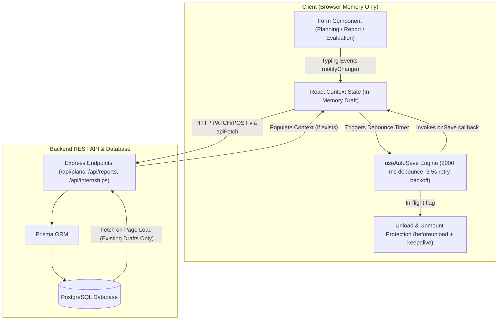

# Server-Only Persistence for Internship Submissions

*   **Author:** Juho Simpanen
*   **Status:** Approved
*   **Date:** 2026-11-20

--------------------------------------------------------------------------------

## Overview

This technical design document defines the architectural transition from hybrid browser-storage persistence to server-only persistence for student internship submissions in Harkkalogi. The system currently stores intermediate drafts of internship plans and final reports in browser `sessionStorage` and `localStorage` (guidance evaluations are already persisted directly to the backend database without client storage). Under this proposal, all student submission content is persisted exclusively to backend database records via authenticated REST APIs, eliminating client-side storage of confidential workplace and evaluation data.

## Problem Statement

Students routinely access the Harkkalogi platform from shared academic environments, such as library workstations, university computer labs, and shared personal laptops. In these environments, browser storage (`sessionStorage` and `localStorage`) presents several privacy and compliance vulnerabilities:

1. **Shared Terminal Data Remanence**: When students close a tab without an explicit logout, or when multiple users share a machine session, cached drafts in browser storage remain inspectable via browser developer tools or storage inspection utilities.
2. **Confidentiality of Workplace Details**: Internship plans and reports frequently describe proprietary employer technologies, internal system architectures, client names, and workplace feedback. Retaining this information unencrypted on the client violates institutional data protection policies.
3. **Disjointed State Synchronization**: Hybrid caching across `sessionStorage`, `localStorage`, React context state, and backend database records creates synchronization drift and race conditions across multiple browser tabs and periods.
4. **Intrusive Logout Warning Modals**: The current implementation intercepts user logout with a modal alert ("Data will be lost if logged out") backed by client-side flusher hooks, creating kiosk session risks when users expect immediate logout on shared terminals.

The proposed solution transitions submission drafts to pure server-side persistence through four primary pillars:
*   **Server-Only Submission Persistence**: Eliminate all client storage for plans and reports, storing draft entities exclusively in PostgreSQL.
*   **Lazy Draft Initialization (Upsert-on-First-Edit)**: Maintain empty templates in React memory and only persist to backend records upon initial user edit.
*   **In-Memory Debounced Auto-Save with Fast Retries**: Auto-save keystrokes after a 2000 ms debounce with a fast 3.5 s retry schedule and explicit error status handling.
*   **Non-Blocking Best-Effort Pre-Logout Flush**: Attempt an 800 ms background flush during logout before clearing credentials, removing intrusive modal popups entirely.

## Goals

*   **Complete Elimination of Client Submission Storage**: Remove all references to `sessionStorage` and `localStorage` for internship plans and reports (guidance evaluations already do not use client storage).
*   **Server-Only Draft Persistence**: Persist draft states directly in the backend PostgreSQL database using existing `DRAFT` status models for plans, reports, and evaluations.
*   **Lazy Draft Initialization (Upsert-on-First-Edit)**: Maintain draft forms in React memory and initialize backend database records only when the student makes their first edit (`isDirty: true`), stage-gated by eligibility (e.g., plan editing enabled for open periods; report editing enabled only after plan approval; evaluation editing enabled only after report approval). This avoids database pollution, duplicate records, and race conditions.
*   **Immediate Flush on Internship Switching**: When a student switches the active internship in the global selector while un-debounced edits exist in memory (`isDirty: true`), immediately trigger a synchronous flush of the current draft before loading the new internship's data.
*   **Non-Blocking Best-Effort Pre-Logout Flush**: Replace `LogoutWarningModal` with an automatic, non-blocking pre-logout flush (`await flushAllDrafts(800)`) with an 800 ms timeout safeguard. In-memory edits waiting in the debounce buffer are flushed before session credentials are wiped, without ever presenting blocking modals to the user.
*   **In-Memory Draft Editing with Debounced Server Saves**: Maintain intermediate typing state in React context memory and dispatch debounced API updates to the server with clear visual status indicators ("Saving...", "Saved", "Connection lost").
*   **Debounced Auto-Save with 3-Step Exponential Backoff**: Implement a 2000 ms debounce timer with up to 3 retries (backoff schedule: 500 ms, 1000 ms, 2000 ms; 3.5 s total) on failure before displaying connection loss, paired with existing `window.onbeforeunload` and `keepalive: true` unmount flushes.

## Non-Goals

*   **Offline Mode**: Operating or buffering edits while disconnected from the network is out of scope. An active network connection is required to edit submissions.
*   **Removing Active Internship ID or Auth Credentials from Storage**: Storing the user's selected active internship ID in session storage is retained; authentication tokens remain governed by existing session and cookie mechanisms.
*   **Collaborative Multi-User Real-Time Editing**: Operational transform or CRDT-based multi-user concurrent editing is not supported. Submissions remain single-student authored.
*   **Multi-Tab Conflict Resolution**: Concurrent editing of the same internship submission across multiple browser tabs uses a Last-Write-Wins (LWW) resolution policy without cross-tab broadcast synchronization overhead.

## Critical User Journeys (CUJs)

### CUJ 1: Student Opens Planning Page (Eligible Stage - In-Memory Template, Server Upsert on First Edit)
*   **Given**: A student is logged in with an active internship that has no existing plan record.
*   **When**: The student navigates to `/planning`.
*   **Then**: The frontend loads an empty plan template into React context memory without dispatching a database write. The page renders with status "Ready to edit". When the student types their first edit, `isDirty` transitions to `true`, and after the 2000 ms debounce, `useAutoSave` dispatches a `PATCH /plans/my-plan?internshipId=...` request to create and save the plan draft in PostgreSQL.

### CUJ 2: Student Opens Report Page (Ineligible Stage - Editing Blocked, No Draft Generated)
*   **Given**: A student has Harjoittelu 1 in progress with its plan still pending teacher approval (`isPlanApproved: false`).
*   **When**: The student navigates to `/report`.
*   **Then**: The system verifies that the prerequisite stage is not satisfied. No draft report record is created in the database. The page displays the standard locked state notice informing the student that plan approval is required first.

### CUJ 3: Student Edits Submission with Debounced Auto-Save & Network Disruption
*   **Given**: A student is actively writing learning goals in `/planning`.
*   **When**: The student types new text.
*   **Then**: Changes are tracked immediately in React memory with the status indicator set to "Unsaved changes". A 2000 ms debounce timer starts. When the timer expires, the client dispatches a `PATCH /plans/my-plan` request to update the server draft. If a network interruption occurs, the client retries the write up to 3 times (500 ms, 1000 ms, 2000 ms backoff, total 3.5 s). If all retries fail, the status indicator transitions to "Connection lost. Unable to save draft." with a manual retry option. If the student resumes typing while in error, the hook transitions to "Unsaved changes" and restarts the debounce timer. If the student attempts to close the browser tab while a save is actively in-flight, the browser prompts the native `onbeforeunload` confirmation.

### CUJ 4: Student Switches Active Internship (In-Memory Flush on Switch)
*   **Given**: A student has Harjoittelu 1 active, types edits into the plan description, and immediately switches to Harjoittelu 2 in the global dropdown within 500 ms (before the 2000 ms debounce timer expires).
*   **When**: The active internship selection changes.
*   **Then**: `PlanContext` intercepts the switch event. Because `isDirty` is true, it immediately triggers `flush()` for Harjoittelu 1's draft, committing edits to the server before resetting in-memory state and loading Harjoittelu 2's plan data. No student edits are lost.

### CUJ 5: Student Logs Out on a Shared Workstation
*   **Given**: A student has finished typing edits on a public campus computer and clicks "Log out" within the 2000 ms debounce window.
*   **When**: The student clicks "Log out" in the user menu.
*   **Then**: `AuthContext.logout` immediately calls `await flushAllDrafts(800)`. If flush succeeds within 800 ms, data is committed. If flush times out or errors, a warning is logged via `console.warn` and `performLogout()` executes without presenting any modal dialogs. Authentication cookies and local tokens are cleared, and the browser redirects to `/login`. No plan or report text remains in `sessionStorage` or `localStorage`.

## Technical Plan (Architecture)

### 1. High-Level Architecture & Data Flow



### 2. Auto-Save Engine Specifications (`useAutoSave`)

The existing `useAutoSave` hook will be adjusted to enforce the following specifications:
*   **Hook Return Contract**:
    ```typescript
    interface AutoSaveReturn {
      status: 'saved' | 'unsaved' | 'saving' | 'error';
      isDirty: boolean;
      isSaving: boolean;
      lastSavedAt: string | null;
      notifyChange: () => void;
      flush: () => Promise<boolean>;
      saveNow: () => Promise<boolean>;
      retry: () => Promise<boolean>;
    }
    ```
*   **Debounce Duration**: 2000 ms.
*   **Condensed Retry Backoff**: On network failure, retry up to 3 times with a condensed schedule:
    *   Retry 1: 500 ms delay
    *   Retry 2: 1000 ms delay
    *   Retry 3: 2000 ms delay
    *   Total retry window: 3.5 seconds.
*   **Status State Machine**:
    *   `"saved"`: Server database reflects latest in-memory state.
    *   `"unsaved"`: Edits in React memory waiting for 2000 ms debounce window.
    *   `"saving"`: HTTP request actively in-flight to the server.
    *   `"error"`: Failed after 3 retries; UI displays connection error notice with retry button wired to `retry()`.
    *   **Typing Recovery from Error**: When `notifyChange()` is called while `status === "error"`, the error condition is cleared, `status` transitions to `"unsaved"`, and the 2000 ms debounce timer restarts.
*   **Operational Definitions for `saveNow` and `retry`**:
    *   `saveNow()`: Clears any active debounce timer and immediately invokes `flush()`, returning `Promise<boolean>`.
    *   `retry()`: Clears the `"error"` status, resets retry attempts, and immediately invokes `flush()`.
*   **In-Flight Unload & Unmount Guards**:
    *   **Native `beforeunload` Guard**: Retain existing `window.addEventListener("beforeunload", handler)` inside `useAutoSave.ts` while `isSavingRef.current === true` or `isDirtyRef.current === true`, preventing accidental tab closure during active network transmission.
    *   **Client Route Unmount Flushes**: `useAutoSave` passes `{ isUnmounting: boolean }` to `onSave`. In `frontend/src/lib/api.ts` (`apiFetch`), when `isUnmounting` is true, pass `{ keepalive: true }` in `RequestInit` to ensure background saves complete across page navigations.

### 3. Lazy Draft Initialization (Upsert-on-First-Edit)

Client context providers manage the draft lifecycle strictly in memory until modified:

1.  **Plan Context (`PlanContext.tsx`)**:
    *   Remove `STORAGE_KEY`, `getStorageKey`, `loadFromStorage`, `setPlan` sessionStorage writes, and all storage cleanup in `resetPlan()`.
    *   On active internship selection, fetch the plan from `activeInternship.plan` (or `/plans/my-plan?internshipId=...`).
    *   If no plan exists in the database, initialize `currentPlan` in React memory with default empty template values. **Do NOT dispatch an eager `POST` request on page load.**
    *   When the student modifies any field, `notifyChange()` sets `isDirty = true` and arms the 2000 ms debounce timer.
    *   Upon timer expiration, `onSave` dispatches `PATCH /plans/my-plan?internshipId=:internshipId` (which uses backend `savePlan` upsert logic to create the record if missing, setting `status: "DRAFT"`).
    *   **Internship Switch Interception**: Whenever `activeInternshipId` changes while `isDirty` is true, execute `await flush()` immediately before setting `currentPlan` to the new internship's data.
2.  **Report Context (`ReportContext.tsx`)**:
    *   Remove `STORAGE_KEY`, `getReportStorageKey`, `loadFromStorage`, and all `sessionStorage` / `localStorage` interactions.
    *   Check stage eligibility: if `activeInternship.isPlanApproved` is false, lock the report form and display prerequisite notice.
    *   If `isPlanApproved` is true, check if `activeInternship.report` exists. If not, hold an empty report template in React memory. **Do NOT dispatch an eager `POST /reports` on page load.**
    *   **Debounced Creation**:
        *   Student typing invokes `notifyChange()`, setting `isDirty = true` and arming the 2000 ms debounce timer.
        *   When `onSave` triggers and `reportId` is null (or temporary in-memory ID):
            *   Dispatch `POST /reports` with `{ internshipId: activeInternship.backendId, title: "...", totalHours: activeInternship.targetHours, status: "DRAFT" }`.
            *   On success, capture the returned report ID in context memory.
        *   Subsequent debounced saves dispatch `PATCH /reports/:id`.
    *   **Internship Switch Interception**: Whenever `activeInternshipId` changes while `isDirty` is true, execute `await flush()` immediately before loading the new internship's report state.
3.  **Guidance Evaluation (`guidance-evaluation/page.tsx`)**:
    *   Clarification: Guidance evaluation already uses direct server persistence without browser storage caching.
    *   Check stage eligibility: if `activeInternship.isReportApproved` is false, lock the evaluation.
    *   When eligible and edited, persist updates via `POST /internships/:id/guidance-evaluation` (which upserts on the backend).
    *   Register its flusher with `draft-registry.ts` using key `'guidance-evaluation'`.

### 4. Non-Blocking Pre-Logout Flush & Modal Removal

*   `frontend/src/components/LogoutWarningModal.tsx`: Delete component permanently.
*   `frontend/src/lib/draft-registry.ts`:
    *   Refactor registry to use keyed `Map<string, DraftFlusher>`:
        ```typescript
        export function registerDraftFlusher(id: string, flusher: DraftFlusher): () => void;
        export async function flushAllDrafts(timeoutMs = 800): Promise<{ allSaved: boolean; failedCount: number }>;
        ```
    *   Keyed registration guarantees idempotent flusher attachment across React StrictMode renders: registering with the same `id` replaces any existing flusher. The returned unregister closure only removes the entry if `map.get(id) === flusher`.
    *   `flushAllDrafts` executes all registered flushers concurrently wrapped in a `Promise.race` against the 800 ms timeout.
*   `frontend/src/context/AuthContext.tsx`:
    *   Remove `LogoutWarningModal` import, state variables, and JSX rendering.
    *   Update `logout` callback:
        ```typescript
        const logout = async () => {
          try {
            const result = await flushAllDrafts(800);
            if (!result.allSaved) {
              console.warn("[Auth] Pre-logout flush incomplete, proceeding with logout", { failedCount: result.failedCount });
            }
          } catch (err) {
            console.warn("[Auth] Pre-logout flush error, proceeding with logout", err);
          } finally {
            await performLogout();
          }
        };
        ```
    *   Logout proceeds unconditionally within 800 ms without modal dialogs or storage flags, saving pending debounce buffer edits when online while never blocking logout on shared kiosks if offline.
*   `frontend/src/lib/submissions-helpers.ts`:
    *   Remove `getPlanStorage` helper that probed browser storage.
    *   Derive all submission statuses purely from `internship.plan`, `internship.report`, and active in-memory context state.

## Risks & Mitigations

### 1. Pre-Logout Network Latency Spikes and Data Drops
*   **Risk**: Students on slow or congested campus Wi-Fi networks who click "Log out" immediately after editing may exceed the 800 ms pre-logout flush window.
*   **Mitigation**:
    *   An 800 ms flush window captures normal network requests while preserving a prompt logout experience.
    *   When `flushAllDrafts` exceeds 800 ms, `AuthContext` logs a warning via `console.warn` and completes logout.
    *   Modal dialogs remain completely eliminated to prioritize terminal security on shared kiosks.

### 2. Multi-Tab Concurrent Editing and Lost Updates
*   **Risk**: A student opening the same plan or report in multiple browser tabs simultaneously may encounter lost updates where Tab B overwrites edits made in Tab A.
*   **Mitigation**:
    *   Single-student submissions use a Last-Write-Wins (LWW) resolution policy.
    *   Concurrent multi-tab editing is designated as an accepted limitation without added client-side synchronization complexity.

### 3. Server Load from Debounced Background Saves
*   **Risk**: Numerous students editing submissions concurrently could generate high database write throughput.
*   **Mitigation**:
    *   The 2000 ms debounce window suppresses writes during active typing, batching updates until a natural pause occurs.
    *   `useAutoSave` checks dirty states before issuing requests, ensuring unmodified forms dispatch zero network traffic.

### 4. Internship Switching Data Loss
*   **Risk**: Switching the active internship in the global dropdown while an edit is within the 2000 ms debounce window could destroy unflushed edits in memory.
*   **Mitigation**:
    *   Both `PlanContext` and `ReportContext` intercept `activeInternshipId` changes. If `isDirty` is true, an immediate `flush()` executes before the context state transitions to the new period.

## Alternatives Considered

### Alternative 1: Short-Lived Encrypted Client Storage
*   **Description**: Encrypting intermediate drafts in browser `sessionStorage` using an ephemeral key derived and stored only in memory during the active session.
*   **Pros**: Retains local draft protection against accidental page reloads while obscuring plaintext content from casual inspection.
*   **Cons**: Adds client cryptographic operations, complex ephemeral key lifecycle management, and leaves persistent encrypted blobs in browser storage on shared public terminals.
*   **Reason for Rejection**: Fails the core institutional security mandate of zero data remanence on shared lab workstations.

### Alternative 2: Explicit Manual Save Only
*   **Description**: Disabling automatic background persistence altogether and requiring students to manually click a "Save Draft" button to push changes to the server.
*   **Pros**: Zero background network writes, predictable server load, and simplified state transitions.
*   **Cons**: Students frequently forget to save multi-page forms; browser tab crashes or accidental navigation causes irreversible work loss.
*   **Reason for Rejection**: Unacceptable user friction and severe risk of student work loss during multi-hour drafting sessions.

### Alternative 3: Client-Side Offline Database (IndexedDB / Service Worker)
*   **Description**: Caching drafts in browser IndexedDB with a Service Worker background synchronization queue to write to the server when online.
*   **Pros**: Full offline editing capability across network interruptions.
*   **Cons**: High implementation complexity with service workers and sync queues; writes unencrypted draft data to local persistent disk storage.
*   **Reason for Rejection**: Writing unencrypted drafts to IndexedDB persistent disk storage directly contradicts the primary privacy requirement of zero client-side data remanence on shared computers.

## Detailed Implementation Plan

### Phasing & Verification Checkpoints

#### Phase 1: Foundation & Primitives
Focus: Core save engine, API client, and draft registry primitives without modifying user-facing contexts.

1.  **Draft Registry (`frontend/src/lib/draft-registry.ts`)**:
    *   Refactor registry to `Map<string, DraftFlusher>` with `registerDraftFlusher(id: string, flusher: DraftFlusher): () => void`.
    *   Ensure idempotent replacement on duplicate `id`, and safe unregistration checking `map.get(id) === flusher`.
    *   Add `timeoutMs` parameter (default 800 ms) to `flushAllDrafts()`, returning `Promise<{ allSaved: boolean; failedCount: number }>`.
2.  **API Client (`frontend/src/lib/api.ts`)**:
    *   Export `interface ApiFetchOptions extends RequestInit { isUnmounting?: boolean; }`.
    *   When `options.isUnmounting` is true, pass `{ keepalive: true }` in `fetch()`.
3.  **Auto-Save Hook (`frontend/src/hooks/useAutoSave.ts`)**:
    *   Update default `debounceMs` to `2000`.
    *   Implement 3-retry loop with backoff (500 ms, 1000 ms, 2000 ms; 3.5 s total) on network failures.
    *   Expose `AutoSaveReturn` interface: `{ status, isDirty, isSaving, lastSavedAt: string | null, notifyChange, flush, saveNow, retry }`.
    *   Implement operational semantics: `saveNow()` clears debounce and calls `flush()`; `retry()` clears error status, resets attempts, and calls `flush()`.
    *   Typing recovery: when `notifyChange()` is called in `"error"` status, transition status to `"unsaved"`, clear error, and restart debounce timer.
    *   Pass `{ isUnmounting: boolean }` flag to `onSave`.
*   **Phase 1 Verification Checkpoint**:
    *   Update `frontend/src/lib/__tests__/draft-registry.test.ts` to test keyed registration and 800 ms timeout.
    *   Run `cd frontend && npm test -- src/lib/__tests__/draft-registry.test.ts`. Gate: test passes.

#### Phase 2: Context State Layer & Internship Switching Flush
Focus: Migrate PlanContext and ReportContext to in-memory state, implement lazy upsert, and guard internship switching.

4.  **Plan Context (`frontend/src/context/PlanContext.tsx`)**:
    *   Purge `STORAGE_KEY`, `getStorageKey`, `loadFromStorage`, `setPlan` sessionStorage writes, and `resetPlan()` storage calls (simplifying `resetPlan()` to `setPlan(EMPTY_PLAN)`).
    *   Manage `currentPlan` strictly in React memory initialized from server record or empty template.
    *   Implement debounced lazy upsert: on first edit (`notifyChange`), arm debounce, and on save dispatch `apiFetch('/plans/my-plan?internshipId=...')`.
    *   Register save flusher with `draft-registry.ts` under key `'plan'`.
    *   Intercept `activeInternshipId` changes: if `isDirty` is true, execute `await flush()` before loading the new internship's plan.
5.  **Report Context (`frontend/src/context/ReportContext.tsx`)**:
    *   Purge `STORAGE_KEY`, `getReportStorageKey`, `loadFromStorage`, `setStore` sessionStorage writes, and storage listeners.
    *   Manage reports store strictly in React memory.
    *   Stage-gate on `isPlanApproved`: if false, keep locked. If true, initialize in memory without DB write.
    *   Debounce initial creation: on first edit, arm debounce. In debounced `onSave`, if report ID is not numeric, dispatch `apiFetch('/reports', { method: 'POST', body: ... })` and store generated ID. Subsequent auto-saves use `apiFetch('/reports/:id', { method: 'PATCH', body: ... })`.
    *   Register save flusher with `draft-registry.ts` under key `'report'`.
    *   Intercept `activeInternshipId` changes: if `isDirty` is true, execute `await flush()` before loading the new internship's report.
6.  **Submissions Helpers (`frontend/src/lib/submissions-helpers.ts`)**:
    *   Remove `getPlanStorage` helper that accessed `sessionStorage` and `localStorage`.
    *   Derive plan and report states strictly from in-memory context data and server `InternshipItem` attributes.
*   **Phase 2 Verification Checkpoint**:
    *   Run `cd frontend && npx tsc --noEmit`. Gate: 0 TypeScript errors.

#### Phase 3: Auth & UI Cleanup
Focus: Eliminate modal warning, update logout flow, and integrate guidance evaluation flusher.

7.  **Auth Context (`frontend/src/context/AuthContext.tsx`)**:
    *   Remove `LogoutWarningModal` import, state, and JSX element.
    *   Update `logout` function to execute `await flushAllDrafts(800)`. If flush fails or times out, log `console.warn("[Auth] Pre-logout flush incomplete, proceeding with logout", { failedCount: result.failedCount })` and proceed with `performLogout()`.
8.  **Logout Warning Modal (`frontend/src/components/LogoutWarningModal.tsx`)**:
    *   Delete component file permanently.
9.  **Guidance Evaluation Page (`frontend/src/app/(shared)/guidance-evaluation/page.tsx`)**:
    *   Update flusher registration to `registerDraftFlusher('guidance-evaluation', flusher)`.
    *   Confirm zero browser storage calls.
*   **Phase 3 Verification Checkpoint**:
    *   Run `cd frontend && npx tsc --noEmit`. Gate: 0 TypeScript errors.

#### Phase 4: Test Suite & End-to-End Verification
Focus: Update existing test suites and add server persistence unit test file.

10. **Test Suite Updates**:
    *   `frontend/src/lib/__tests__/global-internship-switching.test.ts`: Remove assertions expecting localStorage draft keys (`harkkalogi_plan_...`). Verify in-memory state switching.
    *   `frontend/src/lib/__tests__/server-persistence-drafts.test.ts` (NEW): Concrete unit tests using `node:test` and `assert`:
        1. *Zero client storage*: verify `localStorage` and `sessionStorage` methods are never called during draft lifecycle.
        2. *Lazy upsert-on-first-edit*: verify no network calls on mount; first edit triggers debounced `PATCH /plans/my-plan`.
        3. *Exponential backoff retry*: verify 3 retries (500 ms, 1000 ms, 2000 ms) upon network failures.
        4. *Typing error recovery*: verify `notifyChange()` while in `"error"` status resets status to `"unsaved"` and restarts debounce timer.
        5. *Pre-logout flush timeout*: verify `flushAllDrafts(800)` returns `{ allSaved: false, failedCount: 1 }` when a flusher hangs beyond 800 ms.
        6. *Internship switching flush*: verify changing active internship executes `flush()` of dirty in-memory edits.
*   **Phase 4 Verification Checkpoint**:
    *   Run `cd frontend && npm test`. Gate: 100% of tests pass.

### Affected Files Directory

| File Path | Action | Rationale |
| :--- | :--- | :--- |
| `frontend/src/lib/draft-registry.ts` | **MODIFY** | Refactor to keyed `Map<string, DraftFlusher>` with idempotent registration, safe unregistration, and 800 ms timeout in `flushAllDrafts()`. |
| `frontend/src/lib/api.ts` | **MODIFY** | Export `ApiFetchOptions` with `isUnmounting?: boolean` passing `{ keepalive: true }`. |
| `frontend/src/hooks/useAutoSave.ts` | **MODIFY** | Update debounce to 2000 ms, add 3-retry backoff (500/1000/2000 ms), expose complete `AutoSaveReturn` interface (`notifyChange`, `flush`, `saveNow`, `retry`), and error recovery. |
| `frontend/src/context/PlanContext.tsx` | **MODIFY** | Eliminate all `sessionStorage` and `localStorage` interactions; implement debounced lazy upsert via `apiFetch('/plans/my-plan?internshipId=...')`; register flusher under key `'plan'`; flush on internship switch. |
| `frontend/src/context/ReportContext.tsx` | **MODIFY** | Eliminate all `sessionStorage` and `localStorage` interactions; stage-gate report editing; debounced lazy draft creation via `apiFetch('/reports')` and `apiFetch('/reports/:id')`; register flusher under key `'report'`; flush on internship switch. |
| `frontend/src/lib/submissions-helpers.ts` | **MODIFY** | Remove `getPlanStorage` reading from client storage; resolve state from server records and memory context. |
| `frontend/src/app/(shared)/guidance-evaluation/page.tsx` | **MODIFY** | Update flusher registration to `registerDraftFlusher('guidance-evaluation', flusher)`. |
| `frontend/src/context/AuthContext.tsx` | **MODIFY** | Remove `LogoutWarningModal`; execute non-blocking `await flushAllDrafts(800)` with `console.warn` on timeout before `performLogout()`. |
| `frontend/src/components/LogoutWarningModal.tsx` | **DELETE** | Modal permanently removed per user requirement. |
| `frontend/src/lib/__tests__/draft-registry.test.ts` | **MODIFY** | Test keyed registration, 800 ms timeout, and return status structure. |
| `frontend/src/lib/__tests__/global-internship-switching.test.ts` | **MODIFY** | Remove localStorage draft key isolation assertions; assert in-memory/server isolation. |
| `frontend/src/lib/__tests__/server-persistence-drafts.test.ts` | **NEW** | Verify zero client storage usage for submission data, lazy upsert draft creation, 3-retry backoff, error recovery, and flush on internship switch. |
